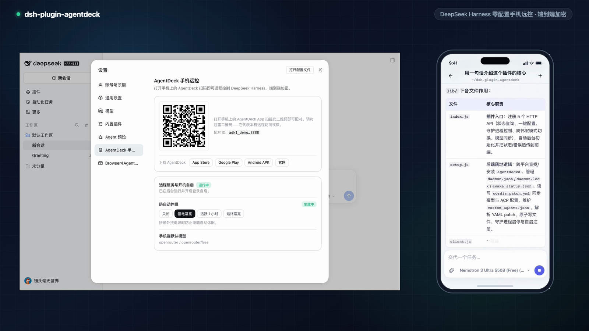

# dsh-plugin-agentdeck

Zero-config mobile remote control plugin for [DeepSeek Harness (`dsh`)](https://github.com/deepseek-ai/deepseek-harness), powered by [AgentDeck](https://agentdeck.xianqiao.wang).

Control DeepSeek Harness from your **iPhone or Android** over native ACP — end-to-end encrypted (`XChaCha20-Poly1305`), with push notifications, file & diff viewing, terminal output, and zero tunnel/VPN setup.



## Zero-Click Setup

Install the plugin and open **Settings → AgentDeck** — everything is provisioned automatically in the background on startup:

- Installs `@openma/deepseek-harness-acp` into the `acp` profile if missing.
- Syncs model & provider config into `~/.dsh/profiles/acp/cordis.patch.yml` (including `acp-plugin.config.provider` for third-party providers like OpenRouter).
- Registers `dsh` in AgentDeck's `custom_agents.json` while preserving your other agents.
- Installs `agentdeckd` automatically and enables OS login autostart (`launchd` / `systemd --user` / Windows Task Scheduler).

The Settings tab stays minimal — just your **scannable pairing QR code** plus the 3 controls you actually need:

1. **Remote Service & Autostart** (`Start` / `Restart` / `Stop`, plus current `agentdeckd` version and manual one-click `Update` when a newer release is available)
2. **Prevent Automatic Sleep** (`Off` / `On Power` / `Active 1h` / `Always`, hot-reloads without restarting)
3. **Mobile Default Model** (shows active model; syncs with your current profile in one click if different)

## Install

### DeepSeek Harness Web / CLI

```bash
dsh plugin --profile web add dsh-plugin-agentdeck
dsh web
```

### DeepSeek Harness Desktop

Open **Settings → Plugins**, install `dsh-plugin-agentdeck`, then open **Settings → AgentDeck** and scan the QR code.

## Get the Mobile App

- [App Store (iOS)](https://apps.apple.com/app/id6821905390) · [TestFlight (iOS Public Beta)](https://testflight.apple.com/join/RWqpYgwm) *(App Store version is not available on the Mainland China App Store)*
- [Google Play (Android)](https://play.google.com/store/apps/details?id=com.mantou.agentdeck)
- [Android APK (GitHub Releases)](https://github.com/mantou132/AgentDeck/releases/latest)
- [AgentDeck Website](https://agentdeck.xianqiao.wang)

## Security, Privacy & Uninstall

> Unofficial third-party plugin for DeepSeek Harness (`dsh`), independently developed and maintained.

- **End-to-End Encryption**: Traffic between your phone and `agentdeckd` is encrypted with `XChaCha20-Poly1305`. The relay only forwards ciphertext envelopes and cannot read prompts, files, or diffs; self-hosted relays are also supported.
- **What Auto-Setup Modifies**:
  - Installs `@openma/deepseek-harness-acp` in the `acp` profile and syncs provider/model config into `~/.dsh/profiles/acp/cordis.patch.yml`.
  - Adds/updates the `dsh` entry in AgentDeck's `custom_agents.json` (`~/Library/Application Support/agentdeck` on macOS, `%LOCALAPPDATA%\agentdeck` on Windows, `~/.local/share/agentdeck` on Linux).
  - Installs `agentdeckd` (via Homebrew / npm / Scoop / local fallback) and registers OS login autostart via `agentdeckd start`.
- **Clean Uninstall**:
  ```bash
  agentdeckd stop                                        # Stop daemon & disable OS autostart
  dsh plugin --profile web remove dsh-plugin-agentdeck   # Remove plugin from DSH
  ```
  *(Optional: uninstall `agentdeckd` via your package manager and remove the `dsh` entry in `custom_agents.json`.)*

---

## 中文说明

> DeepSeek Harness（`dsh`）第三方**非官方**开源插件。

[AgentDeck](https://agentdeck.xianqiao.wang/zh) 的 DeepSeek Harness (`dsh`) 零配置手机远控插件（iOS / Android 原生 App 端到端加密远控，区别于场景 Agent 管理类插件）。

安装启用后会在后台**自动完成全部初始化**（无需手动点击配置按钮）：自动安装 `@openma/deepseek-harness-acp`、同步模型与服务商配置、写入 `custom_agents.json`、安装 `agentdeckd` 并开启系统登录自启。

打开 DSH 的 **设置 → AgentDeck 手机远控** 即可直接扫码配对，界面仅保留最核心的 3 项开关：

1. **远程服务与开机自启**（开启 / 重启 / 停止，显示当前 `agentdeckd` 版本，有新版时提供手动一键更新）
2. **防自动休眠**（关闭 / 插电常亮 / 活跃 1 小时 / 始终常亮，热重载生效）
3. **手机端默认模型**（与当前界面不同时一键同步）

### 安装

```bash
dsh plugin --profile web add dsh-plugin-agentdeck
dsh web
```

打开 **设置 → AgentDeck 手机远控** 扫码即可使用：[App Store](https://apps.apple.com/app/id6821905390)（暂未上架国区）· [TestFlight（iOS 公测版）](https://testflight.apple.com/join/RWqpYgwm) · [Google Play](https://play.google.com/store/apps/details?id=com.mantou.agentdeck) · [Android APK](https://github.com/mantou132/AgentDeck/releases/latest)。

### 安全、隐私与卸载

- **端到端加密**：手机端与本机 `agentdeckd` 之间全程采用 `XChaCha20-Poly1305` 端到端加密，中继服务器仅转发密文，无法读取对话、代码与 diff 内容，亦支持自建中继。
- **本机改动清单**：仅在 `acp` profile 安装 `@openma/deepseek-harness-acp` 并同步 `~/.dsh/profiles/acp/cordis.patch.yml`；在 AgentDeck 数据目录写入 `custom_agents.json` 的 `dsh` 条目；安装 `agentdeckd` 并通过 `agentdeckd start` 注册系统登录自启。
- **彻底停用与卸载**：
  ```bash
  agentdeckd stop                                        # 停止守护进程并取消系统自启
  dsh plugin --profile web remove dsh-plugin-agentdeck   # 卸载 DSH 插件
  ```

## License

MIT
